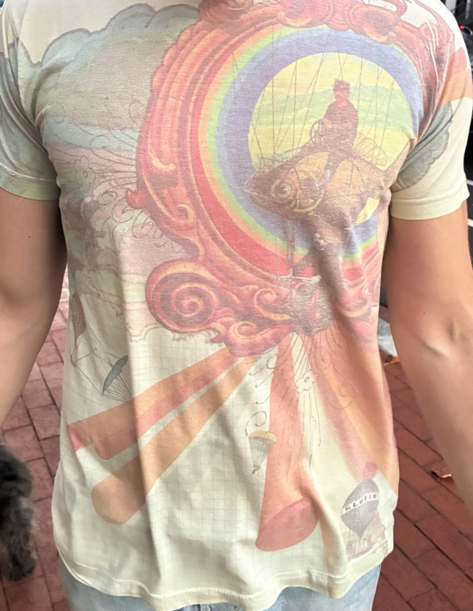

# Shirt Finder

Searches the web every 4 hours for your lost Urban Outfitters shirt (all-over print, about 2004–2008: a man riding a goldfish inside a rainbow scroll frame, with hot-air balloons and parachutes). It emails and texts you when it finds it.



## How it works

| When | Where it looks | Cost |
|---|---|---|
| Every 4 hours | **eBay**: 8 keyword searches, plus eBay's own *search by image* using your photo | Free |
| Once a day | **Google Lens** reverse-image search of your photo (covers Poshmark, Depop, Mercari, Etsy, Grailed, blogs and any other site Google has indexed) | Free tier |
| Once a day | **Google Images**: one keyword search a day, cycling through 6 different searches | Free tier |
| Once a day | **Poshmark**: a Google search limited to poshmark.com, cycling through 6 searches and alternating between all results and only the past month. It never visits Poshmark itself (Poshmark has no public API and its terms forbid bots), and it uses Google's thumbnail of each listing photo. | Free tier |

Each listing it hasn't seen before is sent to **Claude** along with your photo, and Claude decides whether it's the same artwork:

- **Likely match**: you get an email **and** a text with the link
- **Possible match**: you get an email only
- **Different shirt**: it's skipped and never checked again

The program keeps running after it finds something, so you'll hear about every new listing that shows up. To stop it, see the end of this guide.

## Setup (about 30 minutes, one time)

It runs free on **GitHub Actions**, so your Mac doesn't need to be on.

### 1. Put this folder on GitHub
1. Make a free account at github.com.
2. Create a new repository named `shirt-finder`. Make it **Public**. Google Lens needs your shirt photo at a public web address, and a public repository gives it one. The cropped photo shows only the shirt. Your phone number, email and keys are stored as secrets and are never visible.
   - If you'd rather keep the repository private, upload `reference/shirt.jpg` to any public image host and save its link as a `LENS_IMAGE_URL` secret.
3. Upload everything in this folder, including the hidden `.github` folder. The simplest way is GitHub Desktop: *Add existing repository*, then *Publish*.

### 2. Create the accounts and keys
Add each of these under **Settings → Secrets and variables → Actions → New repository secret**:

| Secret name | What to put in it | Where to get it |
|---|---|---|
| `GMAIL_ADDRESS` | The Gmail address that sends the alerts (yours works) | — |
| `GMAIL_APP_PASSWORD` | A 16-character app password | myaccount.google.com/apppasswords (you need 2-Step Verification turned on first) |
| `NOTIFY_EMAIL` | `bradley.g.silverman@gmail.com` | — |
| `SMS_GATEWAY_ADDRESS` | Your carrier's email-to-text address, see below | — |
| `ANTHROPIC_API_KEY` | Claude API key | console.anthropic.com → API Keys. Add $5–10 of credit, which should last months. |
| `SERPAPI_KEY` | SerpAPI key, for Google Lens and Google Images | serpapi.com. The free plan is plenty, since this uses about 90 searches a month. |
| `EBAY_CLIENT_ID` | eBay App ID | developer.ebay.com → create a *Production* keyset |
| `EBAY_CLIENT_SECRET` | eBay Cert ID | Same page as the App ID |

**Text-message address (Verizon):** set `SMS_GATEWAY_ADDRESS` to

```
8453006903@vtext.com
```

Texts sent this way come from your Gmail address. If the test text in step 3 doesn't arrive within a few minutes, try `8453006903@vzwpix.com`, Verizon's picture-message address, which is sometimes more reliable. If neither works, leave the secret blank and you'll get email only, or ask to have Twilio added.

Any secret you skip just turns that part off. **Without `ANTHROPIC_API_KEY`, matching falls back to keywords in listing titles, which is much less accurate.**

### 3. Test it
Go to the **Actions** tab → **Shirt Finder** → **Run workflow**, and run these modes in order:
1. `selftest`: checks the program itself, without searching or sending anything.
2. `test-notify`: you should get a test email and a test text.
3. `dry-run`: runs a real search and prints what it would have sent, without notifying you or saving anything.

After that it runs on its own every 4 hours.

## Day to day
- Every run's log is under the **Actions** tab. If a run fails, GitHub emails you.
- `state/seen.json` lists every listing it has checked, and everything it flagged is under `"matches"`.
- **To stop it:** Actions → Shirt Finder → ⋯ → *Disable workflow*.
- **To add search terms:** edit `EBAY_QUERIES` and `GOOGLE_QUERIES` near the top of `shirt_finder.py`.

## Expected cost
- GitHub Actions, the SerpAPI free tier and the eBay API: **free**
- Claude: the first run checks a few hundred listings and costs about $1–3. After that it only checks new ones, which should come to **a few dollars a month at most**. To cap it, set a monthly spend limit in the Anthropic console.
